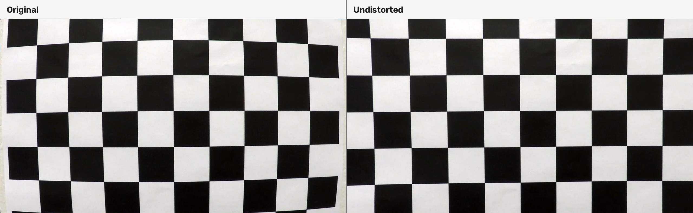
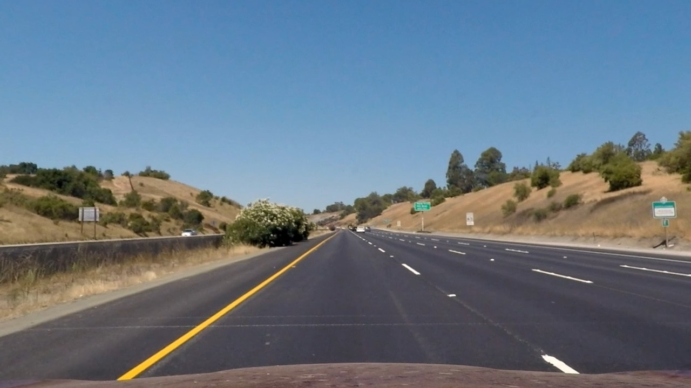
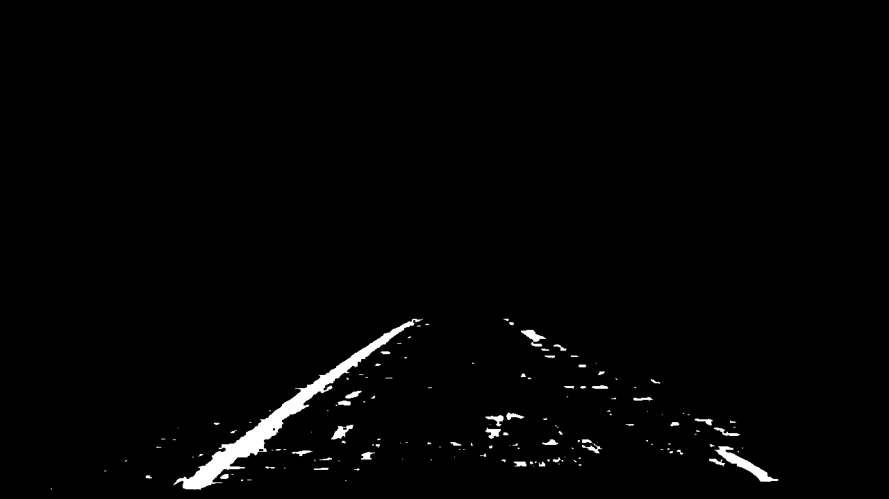
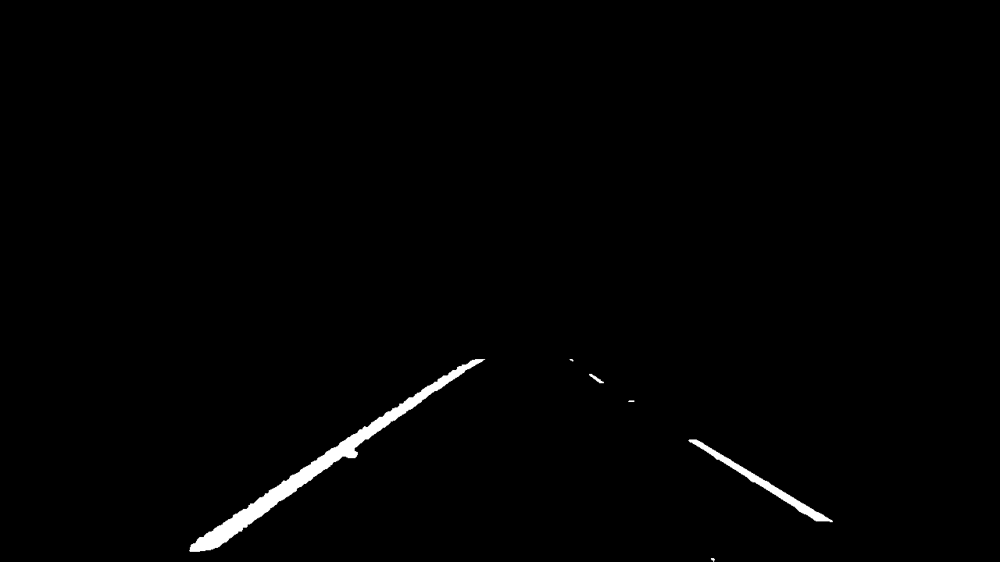
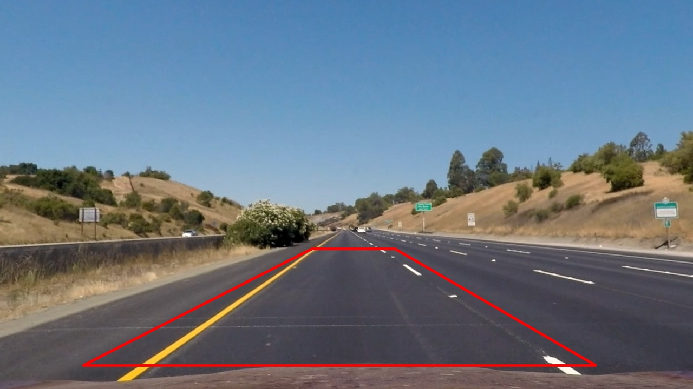
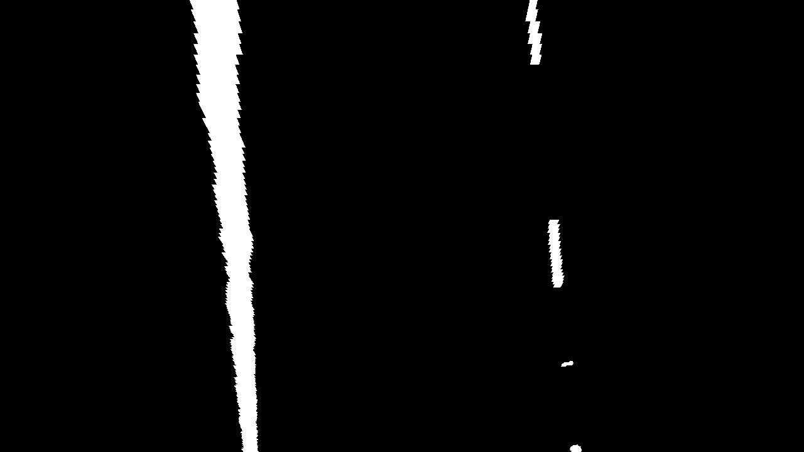
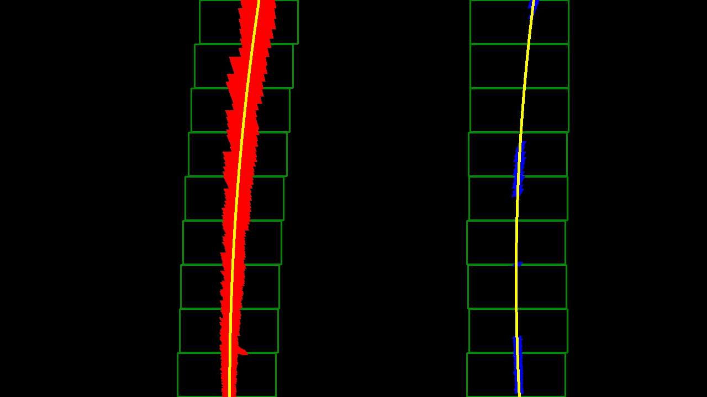
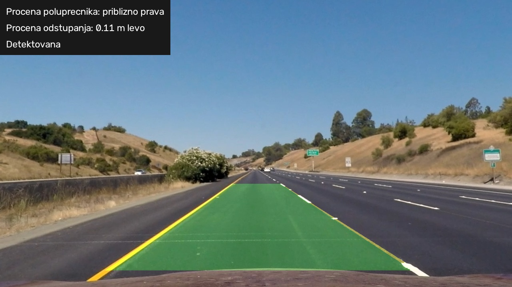
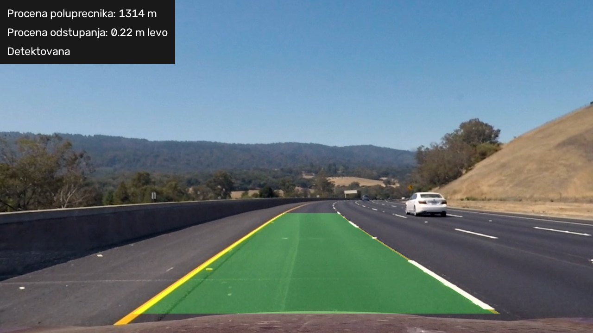

## Writeup Template

### You use this file as a template for your writeup.

---

**Lane Finding Project**

The goals / steps of this project are the following:

* Compute the camera calibration matrix and distortion coefficients given a set of chessboard images.
* Apply a distortion correction to raw images.
* Use color transforms, gradients, etc., to create a thresholded binary image.
* Apply a perspective transform to rectify binary image ("birds-eye view").
* Detect lane pixels and fit to find the lane boundary.
* Determine the curvature of the lane and vehicle position with respect to center.
* Warp the detected lane boundaries back onto the original image.
* Output visual display of the lane boundaries and numerical estimation of lane curvature and vehicle position.

[//]: # (Image References)

[image1]: ./examples/undistort_output.png "Undistorted"
[image2]: ./test_images/test1.jpg "Road Transformed"
[image3]: ./examples/binary_combo_example.jpg "Binary Example"
[image4]: ./examples/warped_straight_lines.jpg "Warp Example"
[image5]: ./examples/color_fit_lines.jpg "Fit Visual"
[image6]: ./examples/example_output.jpg "Output"
[video1]: ./project_video.mp4 "Video"

---

### Writeup / README

#### 1. Provide a Writeup that includes all the rubric points and how you addressed each one.

You're reading it!

### Camera Calibration

#### 1. Briefly state how you computed the camera matrix and distortion coefficients. Provide an example of a distortion corrected calibration image.

Kalibracija kamere implementirana je u fajlu `calibration.py`. Njena svrha je procena parametara kamere i izoblicenja objektiva, kako bi se njihov uticaj smanjio pre detekcije granica trake.

Koristila sam slike sahovske table sa 9 x 6 unutrasnjih uglova. Najpre sam formirala poznate koordinate uglova na ravnoj tabli. Sve tacke imaju koordinatu z = 0, dok raspored ostalih koordinata odgovara rasporedu uglova.

Program prolazi kroz slike iz foldera `camera_cal`, prevodi ih u sive tonove i funkcijom `cv2.findChessboardCorners` trazi uglove. Kada su uglovi pronadjeni, njihov polozaj dodatno precizira funkcijom `cv2.cornerSubPix`.

Dobijene koordinate uglova na slici i odgovarajuce koordinate na tabli prosledjuju se funkciji `cv2.calibrateCamera`, koja racuna matricu kamere i koeficijente izoblicenja.

Od ukupno 20 slika iskorisceno je 15. Na slikama `calibration1.jpg`, `calibration4.jpg` i `calibration5.jpg` uglovi nisu pronadjeni. Slike `calibration7.jpg` i `calibration15.jpg` preskocene su zbog drugacije rezolucije, kako se ne bi direktno mesale koordinate slika razlicitih dimenzija.

Dobijena RMS reprojekciona greska iznosi 0,8529 piksela. Ona opisuje slaganje detektovanih uglova sa polozajima koje predvidja izracunati model, a ne tacnost detekcije trake.

Parametri su sacuvani u fajlu `camera_calibration.npz`, zajedno sa rezolucijom kalibracije i RMS greskom. Tako nije potrebno ponavljati kalibraciju pri obradi svake slike ili videa.

Na sledecem primeru vidi se smanjenje zakrivljenosti linija sahovske table nakon korekcije. Za prikaz korekcije moze da se koristi i slika na kojoj uglovi nisu pronadjeni, jer se primenjuju parametri dobijeni iz drugih uspesno obradjenih slika.

### Pipeline (single images)

#### 1. Provide an example of a distortion-corrected image.

Korekcija izoblicenja slike puta implementirana je u metodi `LaneDetector.undistort`, u fajlu `lane_detection.py`.

Program ucitava matricu kamere, koeficijente izoblicenja i rezoluciju kalibracije iz fajla `camera_calibration.npz`. Ako ulazna slika ima drugaciju rezoluciju, odgovarajuce elemente matrice kamere skalira odnosom sirina i visina.

Funkcijom `cv2.initUndistortRectifyMap` racunaju se mape preslikavanja, a zatim se funkcijom `cv2.remap` dobija korigovana slika. Mape se pamte za svaku rezoluciju, kako se iste vrednosti ne bi ponovo racunale za svaki kadar videa.

Ovaj postupak pretpostavlja da kalibracioni model odgovara ulaznom snimku. Skaliranje matrice ne moze samo po sebi da nadoknadi razlike izmedju drugih kamera, objektiva ili drugacijeg odsecanja slike.

Primer slike puta nakon korekcije:

#### 2. Describe how (and identify where in your code) you used color transforms, gradients or other methods to create a thresholded binary image.  Provide an example of a binary image result.

Formiranje binarne maske implementirano je u metodi `binary_image`, u fajlu `lane_detection.py`.

Najpre primenjujem Gausovo zamucenje sa jezgrom 3 x 3 radi smanjenja sitnog suma. Sliku zatim prevodim iz BGR prostora u HSV i HLS prostor boja, kako bih odvojeno posmatrala nijansu, zasicenost i svetlinu.

Zute oznake izdvajam funkcijom `cv2.inRange`, zadavanjem opsega nijanse, zasicenosti i vrednosti u HSV prostoru.

Bele oznake izdvajam kombinacijom visoke svetline, visoke vrednosti, ogranicene zasicenosti i lokalnog kontrasta.

U pocetnoj verziji prag svetline izdvajao je i velike povrsine svetlog asfalta. Zbog toga sam dodala morfolosku top-hat operaciju nad HLS kanalom svetline. Ona predstavlja razliku izmedju slike i njenog morfoloskog otvaranja, pa istice uske svetle detalje u odnosu na okolinu.

Za ovu operaciju koristim horizontalni pravougaoni element sirine priblizno 2,5% sirine slike i visine 3 piksela. Provera lokalnog kontrasta smanjuje izdvajanje sirokih svetlih povrsina kolovoza.

Kandidate za bele i zute oznake kombinujem u jednu masku. Obradu ogranicavam na trapezoidnu oblast puta, cime iskljucujem nebo i veci deo okoline. Zatim primenjujem morfolosko zatvaranje elementom 3 x 3 radi povezivanja sitnih prekida.

Beli pikseli predstavljaju kandidate za oznake, a ostatak slike je crn. Maska moze da sadrzi i sum od teksture puta, odsjaja ili senki, pa se granice dodatno proveravaju u narednim koracima.

#### 3. Describe how (and identify where in your code) you performed a perspective transform and provide an example of a transformed image.

Transformacija perspektive implementirana je u metodi `perspective`.

U perspektivi kamere granice trake priblizavaju se jedna drugoj prema horizontu. Preslikavanje u pogled odozgo olaksava pronalazenje piksela i uklapanje polinoma.

Izabrala sam cetiri tacke koje obrazuju trapez na slici puta. Njihove koordinate izrazene su u odnosu na dimenzije slike:

- gornja leva: (0.45 * sirina, 0.64 * visina);
- gornja desna: (0.57 * sirina, 0.64 * visina);
- donja desna: (0.86 * sirina, 0.94 * visina);
- donja leva: (0.12 * sirina, 0.94 * visina).

Odredisne tacke obrazuju pravougaonik sa bocnim stranicama na 25% i 75% sirine transformisane slike.

Funkcijom `cv2.getPerspectiveTransform` racunam matricu preslikavanja. Zamenom izvornih i odredisnih tacaka racunam i inverznu matricu, koja se kasnije koristi za vracanje rezultata na put.

Transformaciju binarne slike izvrsavam funkcijom `cv2.warpPerspective`. Koristim interpolaciju najblizim susedom kako ne bih uvodila dodatne sive vrednosti.

Tacke su unapred odredjene i iste relativne vrednosti koriste se za sve scene. Zato granice u transformisanom prikazu nisu na svakoj slici idealno paralelne.

Prikaz izabranog trapeza:

Rezultat transformacije:

#### 4. Describe how (and identify where in your code) you identified lane-line pixels and fit their positions with a polynomial?

Pronalazenje piksela i uklapanje granica implementirani su u metodama `find_fit` i `valid_fit`.

Prvo racunam histogram donje polovine transformisane binarne slike, sabiranjem belih piksela po kolonama. Donji deo koristim zato sto su oznake tu blize kameri i obicno zauzimaju vise piksela.

Maksimum leve polovine histograma koristim kao pocetni polozaj leve granice, a maksimum desne polovine kao pocetni polozaj desne granice.

Zatim koristim devet kliznih prozora koji se krecu od dna prema vrhu slike. U svakom prozoru izdvajam nenulte piksele. Ako ih ima najmanje 30, centar narednog prozora pomeram na njihovu srednju horizontalnu koordinatu.

Polusirina prozora iznosi priblizno 7% sirine slike, uz minimalnu vrednost od 25 piksela. Pomeranje prozora omogucava pracenje granice koja menja polozaj sa visinom slike.

Nakon pretrage spajam odabrane piksele svake strane i funkcijom `np.polyfit` uklapam polinom drugog stepena oblika `x(y) = a*y^2 + b*y + c`.

Za svaku granicu zahtevam najmanje 100 piksela i njihov vertikalni raspon od najmanje 30% visine slike. Time smanjujem mogucnost da polinom bude odredjen samo malom grupom piksela.

Metoda `valid_fit` proverava da su koeficijenti konacni, da granice imaju pravilan redosled, da je njihovo rastojanje prihvatljivo i da se sirina ne menja previse po visini.

Na prikazu su odabrani levi pikseli crveni, desni plavi, prozori zeleni, a uklopljene krive zute.

Polinom omogucava neprekidan prikaz i kod isprekidanih oznaka. Na delovima bez dovoljno podataka taj prikaz predstavlja procenu, a ne direktno detektovanu oznaku.

#### 5. Describe how (and identify where in your code) you calculated the radius of curvature of the lane and the position of the vehicle with respect to center.

Procena poluprecnika zakrivljenosti i polozaja vozila implementirana je u metodi `measurements`.

Koordinate granica prvobitno su izrazene u pikselima. Za priblizno pretvaranje u metre koristim pretpostavljenu sirinu trake od 3,7 m i vidljivu duzinu puta od 30 m.

U kodu polovina sirine transformisane slike odgovara pretpostavljenoj sirini trake, dok visina slike odgovara pretpostavljenoj duzini puta. Faktori konverzije su `xm = 3.7 / (0.50 * sirina)` i `ym = 30.0 / (visina - 1)`.

Koordinate pretvaram u metre i ponovo uklapam polinom. Za polinom `x(y) = a*y^2 + b*y + c` koristim izraz za poluprecnik zakrivljenosti:

`R = (1 + (2*a*y + b)^2)^(3/2) / |2*a|`

Poluprecnik racunam pri dnu transformisane slike za obe granice, a prikazujem njihovu srednju vrednost. Manji poluprecnik odgovara ostrijoj krivini, dok veoma veliki odgovara priblizno pravom putu. Ako je vrednost veca od 10000 m ili nije konacna, prikazujem da je traka priblizno prava.

Za procenu polozaja vozila racunam sredinu leve i desne granice pri dnu transformisane slike. U pojednostavljenom modelu uporedjujem je sa sredinom transformisane slike i razliku pretvaram u metre.

Pozitivna vrednost oznacava referentni polozaj vozila desno od procenjene sredine trake, a negativna levo.

Obe vrednosti su priblizne procene. Zavise od izabrane perspektive, pretpostavljenih fizickih dimenzija i polozaja kamere. Sredina transformisane slike nije automatski precizna fizicka referenca vozila. Za preciznije odredjivanje pomeraja potrebno je preslikati definisanu referentnu tacku vozila u pogled odozgo i preciznije izmeriti skalu.

#### 6. Provide an example image of your result plotted back down onto the road such that the lane area is identified clearly.

Konacan prikaz formira se u metodi `process`.

Na praznoj slici formiram poligon izmedju leve i desne granice i popunjavam ga zelenom bojom pomocu `cv2.fillPoly`. Granice dodatno iscrtavam funkcijom `cv2.polylines`.

Zelenu povrsinu vracam iz pogleda odozgo u perspektivu kamere pomocu inverzne matrice i funkcije `cv2.warpPerspective`.

Zatim funkcijom `cv2.addWeighted` spajam ovaj prikaz sa korigovanom slikom puta. Tezina dodatog prikaza iznosi 0,35, tako da kolovoz ostaje vidljiv ispod zelene povrsine.

Metodom `draw_text_panel` dodajem procenu poluprecnika zakrivljenosti, procenu bocnog pomeraja i status detekcije. Ako procena nije prihvacena, prikazujem poruku da traka nije pouzdano detektovana.

Zelena povrsina ogranicena je na izabrani deo puta, pa ne obuhvata celu sliku do horizonta.

### Pipeline (video)

#### 1. Provide a link to your final video output.  Your pipeline should perform reasonably well on the entire project video (wobbly lines are ok but no catastrophic failures that would cause the car to drive off the road!).

Obrada video-snimaka implementirana je u funkciji `process_video`.

Program otvara ulazni snimak pomocu `cv2.VideoCapture`, redom cita kadrove i na svaki primenjuje postupak detekcije. Rezultate zapisuje u MP4 format pomocu `cv2.VideoWriter`, uz rezoluciju i broj kadrova u sekundi preuzet iz ulaza. Zvuk se ne prenosi.

Za smanjenje podrhtavanja granica koristi se prethodna prihvacena procena. Nova procena kombinuje se sa prethodnom u odnosu 25% prema 75%. Prevelik skok granica izmedju kadrova odbacuje se.

Ako trenutna detekcija ne uspe, prethodna procena moze da se koristi najvise pet uzastopnih kadrova, uz oznaku "Prethodna procena". Nakon duzeg neuspeha procena se uklanja do nove uspesne detekcije.

Izlazni snimci:

- [Prvi video - rezultat](output_videos/project_video01_result.mp4)
- [Drugi video - rezultat](output_videos/project_video02_result.mp4)

Prvi snimak sadrzi 221 kadar, a drugi 681 kadar, pri brzini od 25 kadrova u sekundi.

Oba izlazna snimka su citljiva do kraja. U pregledu uzorkovanih kadrova priblizno na svakih pola sekunde oznacena povrsina ostaje u odgovarajucoj traci, bez uocenog velikog prelaska u susednu traku. Ovo nije vizuelna provera svakog pojedinacnog kadra.

Broj kadrova sa prikazanom procenom ukljucuje i eventualno koriscenje prethodne procene, pa ne predstavlja meru tacnosti detekcije.

### Discussion

#### 1. Briefly discuss any problems / issues you faced in your implementation of this project.  Where will your pipeline likely fail?  What could you do to make it more robust?

Najveci problem tokom razvoja predstavljalo je izdvajanje oznaka na svetlom asfaltu. Pocetni prag svetline prihvatao je i velike delove kolovoza, pa su u uklapanje polinoma ulazili pogresni pikseli.

Dodavanjem lokalnog kontrasta pomocu top-hat operacije ovaj problem je smanjen. Ipak, tekstura puta, odsjaji i granice senki i dalje mogu da stvore sum u binarnoj maski.

Obradjeno je svih 17 testnih slika i sve su prosle ugradjene provere prihvatljivosti. To ne znaci tacnost od 100%, jer nisu dostupne rucno oznacene referentne granice za numericko poredjenje.

Na slabo vidljivim ili isprekidanim oznakama polinom povezuje dostupne delove. Na mestima bez dovoljno piksela granica je procenjena, pa gladak prikaz ne mora da bude potpuno tacan.

Fiksna perspektiva predstavlja dodatno ogranicenje. Ostre krivine, usponi, promena polozaja kamere i drugacija geometrija scene mogu da naruse pretpostavke postupka. Algoritam moze da pogresi i kada vozilo zaklanja oznake ili kada je put prekriven vodom, snegom ili blatom.

Zakrivljenost i bocni pomeraj su priblizne procene zbog pretpostavljene fizicke skale i pojednostavljenog modela polozaja vozila. Njihova fizicka tacnost nije posebno izmerena.

Vremensko izgladjivanje smanjuje podrhtavanje, ali usporava reakciju na nagle promene. Zadrzavanje prethodne procene moze kratkotrajno da prikazuje zastarelu granicu, zbog cega je ograniceno na pet kadrova.

Resenje bi moglo da se unapredi prilagodjavanjem pragova trenutnom osvetljenju, automatskim odredjivanjem perspektive, robusnijim uklapanjem polinoma i posebnom procenom pouzdanosti svake granice. Za preciznije numericke rezultate potrebno je izmeriti fizicku skalu i pravilno definisati referentnu tacku vozila.

Dalje testiranje trebalo bi da ukljuci rucno oznacene granice i dodatne izazovne video-sekvence. Uspesnost na takvim dodatnim snimcima nije potvrdjena prikazanim rezultatima.

